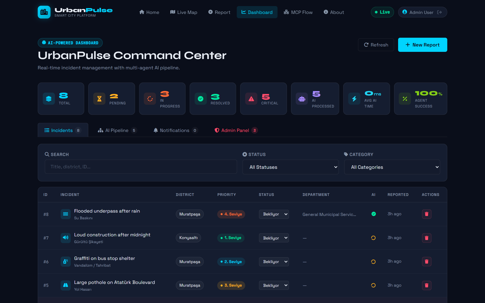
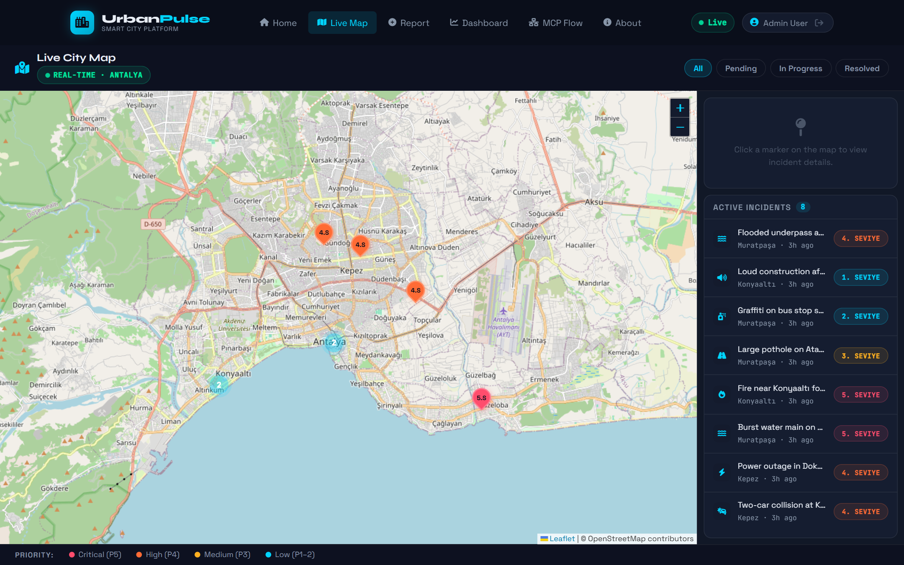
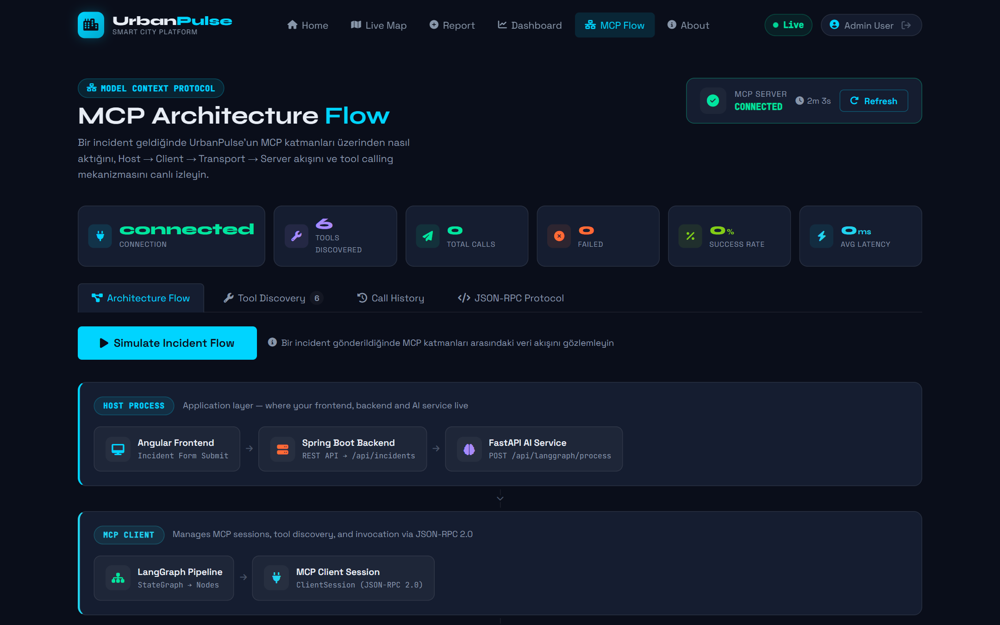
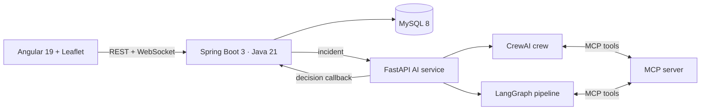

<div align="center">

# 🏙️ UrbanPulse

**Real-time smart-city incident management. Citizens report, AI agents triage and route to the right municipal department.**




</div>

## Highlights

| | |
|---|---|
| 🧠 **Agentic triage** | A CrewAI team (Classifier → Planner → Monitor) and a deterministic LangGraph pipeline decide priority and department |
| 🔌 **MCP tool layer** | Agents call tools over Model Context Protocol (JSON-RPC 2.0); the UI visualises every call live |
| ⚡ **Real time** | WebSockets push new incidents and AI decisions to every open screen, no refresh |
| 🗺️ **Live map** | Leaflet map of Antalya with priority-coloured, clustered markers |
| 🔒 **Secure** | Spring Security + JWT, three roles (Admin / Staff / Citizen), shared secret between backend and AI |

## Screenshots

| Live map | MCP architecture flow |
|:---:|:---:|
|  |  |

## Architecture



| Folder | Role |
|---|---|
| [`frontend/`](frontend) | Angular 19 SPA: signals, Tailwind, Leaflet |
| [`backend/`](backend) | REST API, JWT auth, WebSocket broker, persistence |
| [`ai-service/`](ai-service) | Agents, MCP server, LangGraph + CrewAI pipelines |

## Quick start

```bash
git clone https://github.com/tahircan2/urbanpulse.git && cd urbanpulse
export OPENAI_API_KEY=sk-...          # PowerShell: $env:OPENAI_API_KEY="sk-..."
docker compose up --build
```

Open **http://localhost:4200**. Demo logins (password `test123`, local dev only): `admin@urbanpulse.com`, `staff@urbanpulse.com`, `ahmet@example.com`.

## Docs

[Detailed README](docs/DETAILED_README.md) · [LangGraph report (PDF)](docs/UrbanPulse_LangGraph_Report.pdf) · [CrewAI report](docs/CREW_AI_REPORT.md) · [Contributing](CONTRIBUTING.md)
